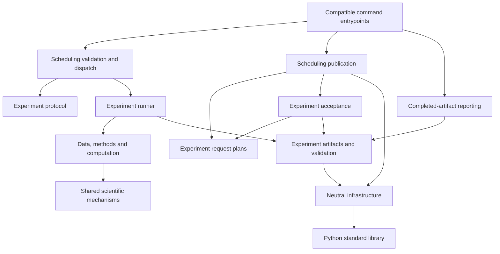

# Repository architecture

The repository groups code by responsibility and scientific experiment. Each
experiment owns its data contract, estimator recipe, evaluation scale, artifact
validator and result namespace. Shared modules reuse mechanisms without making
binary logit, probability and survival contrasts interchangeable.

```text
FedFisher/
  AGENTS.md, README.md, requirements.txt, pyproject.toml
  data.py, models.py, main.py, train_model.py, run_one_shot_algs.py
  algs/, utils/                      original binary and aggregation paths
  synthetic_binary_experiment/       original binary scientific guide
  effect_modifier_experiment/
    components/                      measurement, fingerprints, recovery arithmetic
    infrastructure/                  artifacts, provenance, publication bytes, evidence
    scheduling/                      task catalog, validation, runtime, dispatch
      publication/                   experiment-specific CLI and acceptance composition
    server_scheduler/                schemas, disabled proposals, examples, audit records
    requests.py                      original LASSO request specifications
    causal_comparison/                multiround FedAvg and homogeneous R methods
    one_shot_effects/                 FedFisher-EM, DR-Sieve, SCMV2
      diagnostics/                   saved-model gradient and approximation audits
    fedfisher_timing/                 original Diag/KFAC CPU timing
    model_signal_ablation/            model/signal recipes and recovery
    survival/                        survival methods and recovery epochs
    dslassocov/, one_shot_lasso/       guides and original benchmark invariant validators
    dslassocov_*.py, one_shot_*.py, run_*.py, manage_*.py
                                     preserved original LASSO interfaces
  reporting/binary/                   original binary tables and plots
  reporting/effect_modifier/          factorial, method, timing and replay presentation
  scripts/                           compatible Python commands and historical launch files
  tests/unit/, contracts/, integration/, regression/, architecture/, fixtures/
  docs/architecture.md, development.md, codex/, legacy/
  results/                           preserved small historical material and clone
```

## Dependency direction



Experiment `requests.py` and `recovery_requests.py` own deterministic request
specifications: task parameters, configurations, identities and exact seed
coverage. `build_requests` constructs these specifications without publishing
or selecting machine resources. The scheduling publication modules compose
those plans with source review, scientific admission checks and immutable
outbox publication. Acceptance imports an experiment's plan rather than a CLI.
Source bindings include the actual implementations behind compatible commands.

`catalog.py` declares reviewed task routes and fixed profile contracts using
module names. `validation.py` loads only lightweight protocol definitions.
`runtime.py` sets project scratch/cache paths and the allocated numerical
threads; `dispatch.py` imports the selected numerical runner afterward.
`adapter.py` exposes the stable entrypoint API, and `legacy.py` retains
foreground composition for the original CPU LASSO tasks. None of these modules
registers, enables or submits a central job.

Comparison and standalone timing `computation.py` modules contain path-free
fit/evaluation composition. Model/signal recipes reuse those modules rather
than another experiment's runner. One-shot effects `data_composition.py` owns
observed-data composition and its evidence; `prerequisites.py` owns read-only
gradient prerequisite checks. Diagnostics and validators use those modules
without importing an execution runner. Original public imports remain available
where compatibility requires them.

The shared components preserve existing timing ledgers, array/model fingerprint
formats and tie-aware recovery arithmetic. Each experiment still chooses its
contrast scale and scientific endpoint. Infrastructure uses the standard library
and imports no experiment. Libraries import no `scripts` module. Additional
abstractions require an actual shared contract; this layout adds no universal
experiment schema, estimator interface or generic optimization framework.

## Compatibility and scientific preservation

The registered external adapter path and existing Python command names remain
thin wrappers. Normal imports of moved commands share the implementation module
state. The explicit `scripts` package keeps those compatible imports within the
selected checkout. New code imports the package implementation directly. Report bodies keep
their existing metrics and presentation calculations; lineage identifies the
implementation file after a move.

Original scientific paths remain in place, including `run_one_shot_algs.py`,
`algs/fisher_avg.py`, `train_model.py` and `utils/compress_fisher.py`. Legacy
shell/Slurm workers, scientific manifests, completion markers and historical
results remain preserved. `results/server-scheduler-migration/` is a historical
clone and is never an execution or import source.

The `dslassocov/` and `one_shot_lasso/` packages expose the original four-variant
invariant validators. Their scientific fit/runner/manifest implementations remain
at the original flat paths. The corresponding `scripts/check_*_invariants.py`
commands continue to delegate to those validators; neither move changes the
scientific namespaces or result/completion requirements.

Changing file placement changes source provenance. It does not replace an old
proof's source, permit an old namespace to resume under new source, or relax a
pilot/completion gate. New computation follows the project protocol and central
admission gates. Read [development](development.md), [tests](../tests/README.md)
and [scheduling](../effect_modifier_experiment/scheduling/README.md) for the
implementation and verification boundaries.
